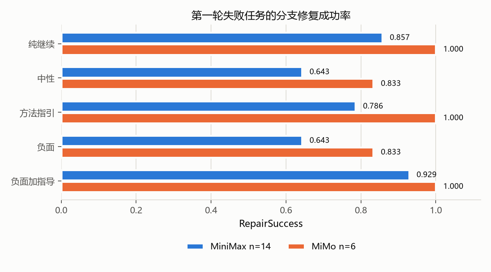
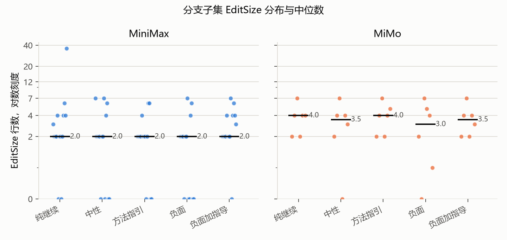

# 负面反馈对代码智能体修复行为与过度修改的影响

## 摘要

本实验研究第一轮修复失败后，用户反馈措辞是否改变代码智能体的第二轮修复行为。任务集为二十四道 Python 缺陷修复题，包含十二道标准题与十二道困难题。两个免费模型 MiniMax-M3.1-Flash 与 MiMo-V2.6-Flash 在五个反馈条件上完成被试内配对运行，条件为纯继续、中性、方法指引、负面、负面加方法指引。主实验采集四十八个第一轮 episode 与一百个分支 episode，另以六题随机顺序复跑检验条件顺序敏感性，以八题无测试消融检验测试可运行性，以二十四题覆盖率与六题变异诊断评估回归测试敏感性。

主实验分支子集中，MiniMax 的修复成功率为纯继续 0.857、中性 0.643、方法指引 0.786、负面 0.643、负面加指导 0.929。MiMo 对应值为 1.000、0.833、1.000、0.833、1.000。所有成对比较经 Holm 校正后均不显著。负面条件下修改行数没有增加，回归测试失败数为零，失败主要表现为未编辑或预算耗尽。随机顺序复跑未重现负面加指导最高的模式，负面与负面加指导的修复成功率均为 0.600，低于纯继续的 0.800。无测试消融中 MiniMax 的负面仍为五条件最低，通过 4/8，纯继续为 8/8。

现有数据不支持负面反馈提高修复成功或导致过度修改的假设。负面措辞与较低的修复成功率相关，主要机制是继续搜索而不编辑。方法指引的描述性表现达到或优于单纯负面反馈，但样本量不足以支持稳定结论。条件顺序、单次运行、预算截断与回归测试敏感性构成主要效度威胁。

## 1. 研究问题与假设

研究问题为第一轮修复失败后，用户的负面反馈会促使代码智能体更谨慎地定位错误，还是导致过度修改、无关重构与回归错误。

预注册假设如下。

| 编号 | 假设 | 检验结果 |
|---|---|---|
| H1 | 负面反馈提高第二轮修复成功率，同时增加修改规模与回归错误 | 不支持。负面条件成功率较低，修改行数没有增加，回归失败为零 |
| H2 | 方法指引比单纯负面反馈更有效 | 描述性支持。主实验与消融中方法指引均高于负面，但差异不显著 |
| H3 | 负面加方法指引取得最好的成功率与修改规模平衡 | 不稳定。主实验最高，随机顺序复跑与无测试消融未重现 |
| H4 | 可运行测试会削弱负面反馈的负面影响 | 方向一致但证据弱。无测试时负面与纯继续的差距更大，然而消融同时改变提示与顺序 |
| H5 | 能力较弱的模型对反馈措辞更敏感 | 部分支持。MiniMax 的条件波动明显大于 MiMo，MiMo 存在天花板 |

## 2. 任务集与校准

任务集共二十四题，覆盖边界条件、函数逻辑、正则、数据处理、类型转换、排序查找与 API 参数误用七类。每题包含一个 buggy 仓库、一个 gold 补丁、一至两个目标测试与六至十四项回归测试，回归测试合计二百九十七项。题目经过结构检查、泄漏检查、buggy 与 gold 双态验证、补丁范围检查、测试哈希检查与五轮确定性检查。

难度校准使用 DeepSeek-V4-Pro 盲解，二十四题全部通过，无测试篡改，单题工具调用上限十五次，合计费用 0.227416 美元。盲解只用于排除无解、歧义与明显过易的题，不进入正式比较。人工复核表由复核人签字后任务集冻结，冻结清单见 `RECORD/analysis/main_manifest.json`。

难度分层在正式模型中并不均匀。MiniMax 第一轮通过十题，失败十四题。MiMo 第一轮通过十八题，失败六题。两模型共同失败题为 T13、T14、T18、T19、T20、T24。MiMo 的失败题较少，导致其分支样本只有六题，条件比较功效很低。

## 3. 实验环境与设计

实验使用 OpenCode 1.18.25，`--format json --pure --auto`，build agent，隔离的配置目录与数据目录。第一轮最多十次工具调用，第二轮最多十五次，编辑上限八次，单次超时三百秒。允许读取、编辑、glob、grep 与 list，Bash 仅允许 `python -m pytest`。测试文件哈希受到监控，若分支修改测试文件，评分前还原并用原始测试评分。

每个模型对每道题先运行统一的第一轮提示。第一轮失败后，从同一份第一轮终态复制五个独立分支，分别注入五句反馈之一。五份提示的 issue、第一轮 diff 与失败日志逐字相同，只有反馈句不同。第一轮通过的任务不进入分支，但在全样本 PassRate 中复用第一轮终态。

指标定义如下。EditSize 为累计新增与删除的非测试源码行数。EditRatio 为 EditSize 除以 gold 补丁行数。RepairSuccess 的分母为第一轮失败题数。RegressionRate 为失败回归测试数除以回归测试总数。OverEdit 定义为 EditRatio 大于二。

主实验的条件顺序固定为纯继续、中性、方法指引、负面、负面加指导。该顺序与任务内位置完全共线，是预注册方案的偏差。为估计顺序敏感性，补充运行在任务内随机化五条件顺序，种子由 run_id、模型与任务名派生。

## 4. 主实验结果

主实验完成四十八份第一轮 summary 与一百个分支 episode。无缺失、无超时、无分支继承不一致。七次测试文件修改被检测并在评分前还原。表 1 给出分支子集结果，条件差异只来自第一轮失败题。

| 模型 | n | 纯继续 | 中性 | 方法指引 | 负面 | 负面加指导 |
|---|---:|---:|---:|---:|---:|---:|
| MiniMax | 14 | 0.857 | 0.643 | 0.786 | 0.643 | 0.929 |
| MiMo | 6 | 1.000 | 0.833 | 1.000 | 0.833 | 1.000 |

全样本 PassRate 因复用第一轮通过题而更高。MiniMax 为 0.917、0.792、0.875、0.792、0.958。MiMo 为 1.000、0.958、1.000、0.958、1.000。全样本数字适合描述整体成功率，不适合解释条件效应。

MiniMax 的负面与中性并列最低，负面加指导最高。MiMo 的纯继续、方法指引与负面加指导均为满分，中性与负面各低一题。两模型的修改行数中位数均为二至四行，EditRatio 中位数多为一，OverEditRate 在 MiniMax 为 0.042 至 0.083，在 MiMo 为零至 0.042。回归测试失败数为零。





预算截断需要单独说明。MiniMax 七十个分支 episode 中百分之七十一点四耗尽十五次工具调用，负面条件为百分之九十二点九。MiMo 三十个分支中百分之六点七耗尽预算。MiniMax 的失败中有相当部分不是形成错误补丁，而是在读取与搜索后未编辑即结束。因此 EditSize 较低不能直接解释为修改更谨慎。

## 5. 条件比较与效应量

MiniMax 的五条件整体检验为 Cochran's Q 等于 7.111，p 等于 0.130。MiMo 为 Q 等于 3.000，p 等于 0.558。修改行数的 Friedman 检验在 MiniMax 为 3.219，p 等于 0.522，在 MiMo 为 2.933，p 等于 0.569。十个成对比较的 McNemar 精确检验与 Wilcoxon 符号秩检验经 Holm 校正后均不显著。

MiniMax 的负面对纯继续风险差为 0.214，未校正 p 等于 0.375。负面加指导对纯继续风险差为负 0.071，未校正 p 等于 1.000。方法指引对负面风险差为 0.143，未校正 p 等于 0.500。Cliff's delta 的置信区间均跨零。当前样本量下，检验无法区分小幅条件差异与随机波动。

描述性模式有三点。第一，负面条件没有提高成功率。第二，方法指引高于负面，方向与 H2 一致。第三，负面加指导在主实验最高，但在补充运行中不稳定。前两点在两模型上方向一致，第三点只出现在主实验。

## 6. 模型比较

在六道共同失败题上，MiMo 的分支通过数为 28/30，MiniMax 为 19/30。MiMo 的负面条件为 5/6，MiniMax 为 2/6。MiMo 的修改行数中位数为四，MiniMax 为二。该比较为描述性，六题不足以支持模型总体优劣结论。

MiniMax 的条件波动更大，预算耗尽更频繁，未编辑失败更多。MiMo 的第一轮通过率更高，分支阶段接近天花板，条件差异主要集中在中性与负面各一题。H5 的方向得到部分支持，但天花板效应使 MiMo 的反馈敏感性无法充分估计。

## 7. 回归测试敏感性

二十四题回归测试的语句覆盖率总体为 0.916，gold 文件为 0.908，非 gold 文件为 0.918。最低为 T15 的 0.837，最高为 T21 的 1.000。覆盖率说明回归测试并非只覆盖目标函数，但仍存在未覆盖路径。

变异诊断在六道困难题上生成四十七个变异体，回归测试杀死三十七个，变异得分为 0.787。T13 为 0.375，T20 为 0.625，T14 与 T24 为 1.000。存活变异体中可能包含语义等价变异，因此 0.787 应视为敏感性下界。

主实验与消融的 RegressionRate 均为零。结合覆盖率与变异得分，零回归只能说明当前样本未观察到回归测试失败，不能说明模型没有引入行为变化。T13 与 T20 的回归测试对非目标改动不敏感，涉及这两题的零回归结果尤其不能作强解释。

## 8. 随机顺序复跑

复跑选择 T05、T09、T14、T18、T19、T24，两模型五条件，条件顺序在任务内随机化。十二份 summary 与三十五个分支 episode 完整，审计通过。MiMo T24 负面分支修改测试文件，评分前已还原。

| 模型 | n | 主运行 PassRate | 复跑 PassRate | 通过一致率 | Cohen kappa | ICC(2,1) EditSize | Spearman rho |
|---|---:|---:|---:|---:|---:|---:|---:|
| MiniMax | 25 | 0.680 | 0.720 | 0.680 | 0.324 | -0.178 | 0.011 |
| MiMo | 10 | 1.000 | 1.000 | 0.900 | 0.000 | 0.166 | 0.401 |

MiniMax 复跑的分条件修复成功率为纯继续 0.800、中性 0.800、方法指引 0.800、负面 0.600、负面加指导 0.600。主实验对应值为 0.857、0.643、0.786、0.643、0.929。负面加指导最高的模式没有重现，负面与负面加指导均低于纯继续。

通过一致率 0.680 与负的 ICC 说明单次运行的条件差异包含较大随机波动。MiMo 的通过一致率为 0.900，但 kappa 为零，原因是边际分布退化，不能作为稳定性的强证据。复跑结果削弱了主实验的因果解释，说明固定条件顺序与条件共线是实质威胁。

## 9. 无测试消融

消融选择 T05、T06、T13、T14、T18、T19、T20、T24。配置拒绝全部 Bash 调用，第一轮提示说明当前环境不允许运行测试，第二轮仍提供第一轮失败日志。十六份 summary 与五十个分支 episode 完整。六十六个 episode 中二十五个出现 Bash 尝试，共二十六次，二十六次均返回工具不可用，成功完成零次，测试篡改零次。

| 模型 | 条件 | 主运行通过 | 消融通过 | 主运行 EditSize | 消融 EditSize |
|---|---|---:|---:|---:|---:|
| MiniMax | 纯继续 | 7/8 | 8/8 | 2.5 | 4.0 |
| MiniMax | 中性 | 5/8 | 7/8 | 2.0 | 2.0 |
| MiniMax | 方法指引 | 6/8 | 8/8 | 2.0 | 3.0 |
| MiniMax | 负面 | 4/8 | 4/8 | 1.0 | 2.0 |
| MiniMax | 负面加指导 | 7/8 | 6/8 | 2.5 | 2.5 |
| MiMo | 纯继续 | 8/8 | 8/8 | 3.0 | 3.0 |
| MiMo | 中性 | 7/8 | 8/8 | 2.5 | 3.0 |
| MiMo | 方法指引 | 8/8 | 8/8 | 3.0 | 3.0 |
| MiMo | 负面 | 7/8 | 8/8 | 2.0 | 3.0 |
| MiMo | 负面加指导 | 8/8 | 8/8 | 2.5 | 3.0 |

MiniMax 总通过数由 29/40 升至 33/40。增益集中在纯继续、中性与方法指引，负面没有变化，负面加指导下降一题。MiMo 由 38/40 升至 40/40，出现天花板。

MiniMax 的负面失败四题中三题未编辑，负面加指导失败两题均未编辑。负面与负面加指导的预算耗尽分别为 7/8 与 8/8。无测试环境没有消除负面条件的低成功率，反而使负面与纯继续的差距扩大。该方向与 H4 一致，但消融同时改变测试可用性、提示词与条件顺序，不能把差异单独归因于测试。

## 10. 质性观察

质性抽样按模型与条件分层，每个组合最多抽取两个成功与两个失败 episode，共三十一条，名单与材料路径见 `RECORD/analysis/qualitative/qualitative_samples.csv`。系统编码表尚未完成，本报告只报告三个可追溯案例，不报告编码频次，也不把空编码当作否定。

案例一为 MiniMax T05 负面成功。累计 diff 只修改邮箱正则的一个字符类，将 local part 的字符集合扩展为包含加号，新增与删除共两行，EditRatio 为一。该案例表现为局部最小修改。

```diff
-    r"[A-Za-z0-9._%-]+@[A-Za-z0-9.-]+\.[A-Za-z]{2,}"
+    r"[A-Za-z0-9._%+-]+@[A-Za-z0-9.-]+\.[A-Za-z]{2,}"
```

案例二为 MiniMax T05 中性成功。模型把 local part 与 domain 提取为模块级常量，并改写整个正则为 f-string，累计七行，EditRatio 为 3.5。修改正确，但超出最小必要范围。

案例三为 MiniMax T14 负面失败。分支十五次工具调用全部用于读取与搜索，读取八个源码与测试文件，三次 Bash 尝试被拒绝，未产生任何编辑。该案例说明负面条件的低 EditSize 可能来自未编辑失败，而不是谨慎定位。

三个案例共同提示，反馈措辞可能改变探索与落笔的时机。负面条件下既有最小成功，也有大量未编辑失败。仅用平均修改行数无法区分谨慎与停滞，后续分析应把 any_edit、no_edit_failure 与编辑正确性分开报告。

## 11. 效度威胁

第一，主实验条件顺序固定，条件与任务内位置完全共线。随机顺序复跑只有六题，且结果方向改变，说明主实验的条件差异不能作因果解释。

第二，样本量小。MiniMax 有十四道失败题，MiMo 只有六道。McNemar 检验在十四对样本下需要至少六个单向不一致对才能达到双侧 0.05，当前最大不一致对不足以拒绝零假设。不显著不能解释为无效应。

第三，单次运行无法区分条件效应与运行间波动。复跑显示 MiniMax 的通过一致率为 0.680，EditSize 的 ICC 为负，说明噪声不可忽略。

第四，MiMo 存在明显天花板，第一轮通过十八题，分支阶段多数条件满分，反馈敏感性无法充分估计。

第五，预算截断普遍。MiniMax 百分之七十一点四的分支耗尽工具调用，负面条件为百分之九十二点九。预算耗尽与未编辑失败使 EditSize 与 RepairSuccess 的解释复杂化。

第六，回归测试零方差。覆盖率总体较高，但 T13 与 T20 的变异得分低，零回归不能作为无回归的强证据。

第七，无测试消融不是单一变量操纵。消融同时改变 Bash 权限、第一轮提示与条件顺序，且同批八题中 MiMo 第一轮通过数由两题升至六题，说明第一轮行为已改变。

第八，任务集为构造题，issue 与测试均由实验者编写，外部效度有限。免费模型的行为可能随服务端版本变化，实验只代表 2026-10-21 的 OpenCode 1.18.25 环境。

第九，质性编码尚未完成，案例观察不能替代系统编码，也不能支持条件间的频次比较。

## 12. 结论与建议

在本实验条件下，未观察到负面反馈使代码智能体更谨慎，也未观察到更多过度修改。负面条件与较低的修复成功率相关，失败主要表现为未编辑或预算耗尽。方法指引的描述性成功率达到或高于单纯负面反馈，但差异不显著。负面加方法指引在主实验最高，未能在随机顺序复跑与无测试消融中稳定重现。

对实际使用，反馈措辞不应依赖单纯表达不满。若希望智能体继续修复，方法指引比负面措辞更有描述性优势。若希望减少过度修改，应同时监控是否发生编辑，而不只监控修改行数。

对后续研究，建议在任务内随机化条件顺序，增加每条件重复运行，扩大困难题样本，分离未编辑失败与错误编辑，使用变异得分更高的回归测试，并对质性材料进行双人编码。当前数据适合作为探索性证据，不适合支持强因果结论。

## 附录 数据与复现

主实验表位于 `RECORD/tables/`。统计结果位于 `RECORD/analysis/main_results.md`、`RECORD/analysis/main_results.csv` 与 `RECORD/analysis/statistics.json`。复跑结果位于 `RECORD/analysis/reliability/`。消融结果位于 `RECORD/analysis/ablation/`。回归敏感性结果位于 `RECORD/analysis/regression_sensitivity.md`。质性材料位于 `RECORD/analysis/qualitative/`。

分析脚本为 `harness/analyze.py`、`harness/aggregate.py`、`harness/regression_sensitivity.py`、`harness/count_tool_attempts.py` 与 `harness/make_figures.py`。随机种子为 20261021，bootstrap 重采样一万次。运行环境与包版本见 `requirements.txt`。
