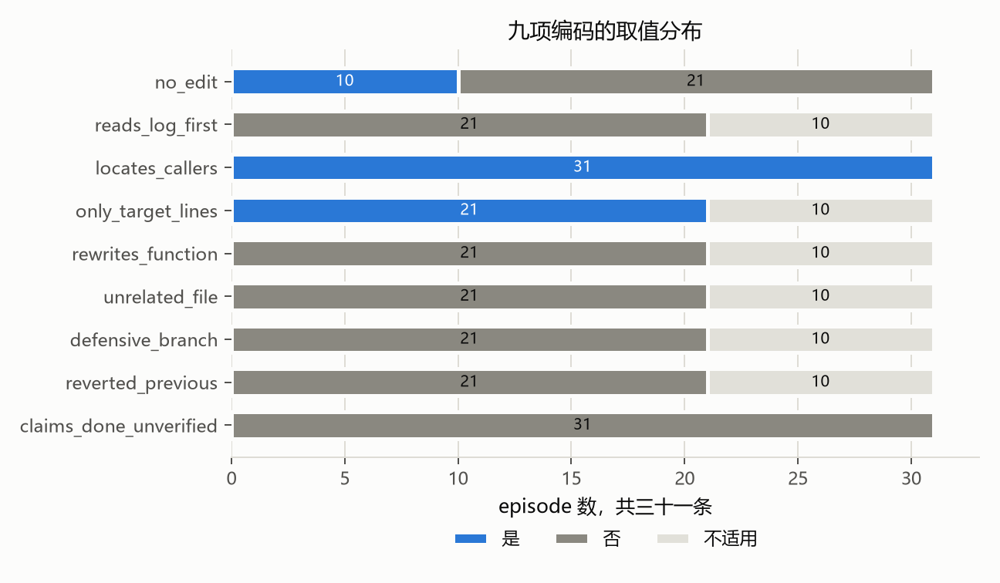
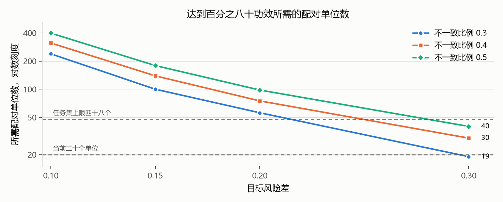
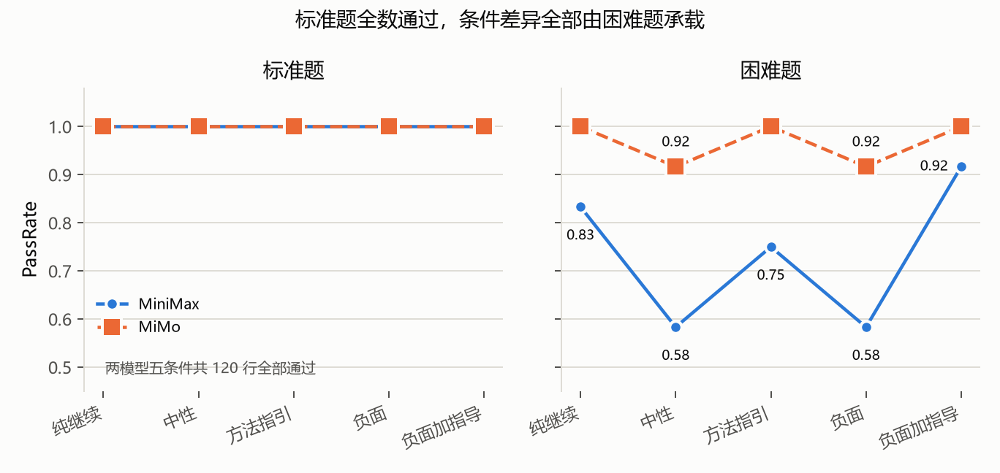

# 负面反馈对代码智能体修复行为与过度修改的影响

> 版本 v1 草稿
> 日期 2026-10-23
> 上一版本 `../report_v0/report_v0.md`，本稿在其基础上补入质性编码、过程指标、预算补跑、功效分析与敏感性分析

## 摘要

本实验研究第一轮修复失败后，用户反馈措辞是否改变代码智能体的第二轮修复行为。任务集为二十四道 Python 缺陷修复题，包含十二道标准题与十二道困难题。两个免费模型 MiniMax-M3.1-Flash 与 MiMo-V2.6-Flash 在五个反馈条件上完成被试内配对运行，条件为纯继续、中性、方法指引、负面、负面加方法指引。主实验采集四十八份第一轮 summary 与一百个分支 episode，另以六题随机顺序复跑检验条件顺序敏感性，以八题无测试消融检验测试可运行性，以二十四题覆盖率与六题变异诊断评估回归测试敏感性，以十六例双倍预算补跑检验预算截断的影响。

主实验分支子集中，MiniMax 的修复成功率为纯继续 0.857、中性 0.643、方法指引 0.786、负面 0.643、负面加指导 0.929。MiMo 对应值为 1.000、0.833、1.000、0.833、1.000。所有成对比较经 Holm 校正后均不显著。负面条件下修改行数没有增加，回归测试失败数为零。

三十一条质性编码显示失败以未编辑为主，十一条失败中十条从未改动文件；发生编辑的二十一条全部只在目标文件内做局部修改，未出现整体重写、无关文件、防御性分支或未验证的完成声明。编码者间一致率为 0.989，编码者内重编码一致率为 1.000，两项一致率均由语言模型编码者产生。

功效分析显示配对单位只有二十个，其中 MiniMax 十四个单位的十个比较按观察到的不一致对数计无法达到显著，合并二十个单位后的最小可检测风险差约为 0.28 至 0.38。敏感性分析显示十二道标准题在五个条件下全部通过，条件差异全部由困难题承载，未被预算截断的失败全样本仅两个。

现有数据不支持负面反馈提高修复成功或导致过度修改的假设。负面措辞与较低的修复成功率相关，机制更接近延长探索与抑制编辑，而不是改坏代码。条件顺序、单次运行、预算截断、样本量与回归测试敏感性构成主要效度威胁，设计不支持因果结论。

本报告保留宽窄两种表述。宽表述以全部题目为范围，窄表述限定于困难题并说明设计的最小可检测效应，二者在汇报中先后呈现，后者是前者的收窄而不是推翻。

## 1 研究问题与假设

研究问题为第一轮修复失败后，用户的负面反馈会促使代码智能体更谨慎地定位错误，还是导致过度修改、无关重构与回归错误。

预注册假设与检验结果如下。

| 编号 | 假设 | 检验结果 |
|---|---|---|
| H1 | 负面反馈提高第二轮修复成功率，同时增加修改规模与回归错误 | 不支持。负面条件成功率较低，修改行数没有增加，回归失败为零，质性编码未发现过度修改 |
| H2 | 方法指引比单纯负面反馈更有效 | 描述性支持。主实验与消融中方法指引均高于负面，但差异不显著，功效分析显示无法区分 |
| H3 | 负面加方法指引取得最好的成功率与修改规模平衡 | 不稳定。主实验最高，随机顺序复跑与无测试消融未重现 |
| H4 | 可运行测试会削弱负面反馈的负面影响 | 方向一致但证据弱。无测试时负面与纯继续的差距更大，然而消融同时改变提示与顺序 |
| H5 | 能力较弱的模型对反馈措辞更敏感 | 部分支持。MiniMax 的条件波动明显大于 MiMo，MiMo 存在天花板 |

## 2 任务集与校准

任务集共二十四题，覆盖边界条件、函数逻辑、正则、数据处理、类型转换、排序查找与 API 参数误用七类。每题包含一个 buggy 仓库、一个 gold 补丁、一至两个目标测试与六至十四项回归测试，回归测试合计二百九十七项。题目经过结构检查、泄漏检查、buggy 与 gold 双态验证、补丁范围检查、测试哈希检查与五轮确定性检查。

难度校准使用 DeepSeek-V4-Pro 盲解，二十四题全部通过，无测试篡改，单题工具调用上限十五次，合计费用 0.227416 美元。盲解只用于排除无解、歧义与明显过易的题，不进入正式比较。人工复核表由复核人签字后任务集冻结，冻结清单见 `RECORD/analysis/main_manifest.json`。

难度分层在正式模型中并不均匀。MiniMax 第一轮通过十题，失败十四题。MiMo 第一轮通过十八题，失败六题。两模型共同失败题为 T13、T14、T18、T19、T20、T24。MiMo 的失败题较少，导致其分支样本只有六题，条件比较功效很低。

## 3 实验环境与设计

实验使用 OpenCode 1.18.25，`--format json --pure --auto`，build agent，隔离的配置目录与数据目录。第一轮最多十次工具调用，第二轮最多十五次，编辑上限八次，单次超时三百秒。允许读取、编辑、glob、grep 与 list，Bash 仅允许 `python -m pytest`。测试文件哈希受到监控，若分支修改测试文件，评分前还原并用原始测试评分。

每个模型对每道题先运行统一的第一轮提示。第一轮失败后，从同一份第一轮终态复制五个独立分支，分别注入五句反馈之一。五份提示的 issue、第一轮 diff 与失败日志逐字相同，只有反馈句不同。第一轮通过的任务不进入分支，但在全样本 PassRate 中复用第一轮终态。

指标定义如下。EditSize 为累计新增与删除的非测试源码行数。EditRatio 为 EditSize 除以 gold 补丁行数。RepairSuccess 的分母为第一轮失败题数。RegressionRate 为失败回归测试数除以回归测试总数。OverEdit 定义为 EditRatio 大于二。

主实验的条件顺序固定为纯继续、中性、方法指引、负面、负面加指导。该顺序与任务内位置完全共线，是预注册方案的偏差。为估计顺序敏感性，补充运行在任务内随机化五条件顺序，种子由 run_id、模型与任务名派生。

## 4 主实验结果

主实验完成四十八份第一轮 summary 与一百个分支 episode。无缺失、无超时、无分支继承不一致。七次测试文件修改被检测并在评分前还原。表 1 给出分支子集结果，条件差异只来自第一轮失败题。

| 模型 | n | 纯继续 | 中性 | 方法指引 | 负面 | 负面加指导 |
|---|---:|---:|---:|---:|---:|---:|
| MiniMax | 14 | 0.857 | 0.643 | 0.786 | 0.643 | 0.929 |
| MiMo | 6 | 1.000 | 0.833 | 1.000 | 0.833 | 1.000 |

全样本 PassRate 因复用第一轮通过题而更高。MiniMax 为 0.917、0.792、0.875、0.792、0.958。MiMo 为 1.000、0.958、1.000、0.958、1.000。全样本数字适合描述整体成功率，不适合解释条件效应。

MiniMax 的负面与中性并列最低，负面加指导最高。MiMo 的纯继续、方法指引与负面加指导均为满分，中性与负面各低一题。两模型的修改行数中位数均为二至四行，EditRatio 中位数多为一，OverEditRate 在 MiniMax 为 0.042 至 0.083，在 MiMo 为零至 0.042。回归测试失败数为零。

预算截断需要单独说明。MiniMax 七十个分支 episode 中百分之七十一点四耗尽十五次工具调用，负面条件为百分之九十二点九。MiMo 三十个分支中百分之六点七耗尽预算。MiniMax 的失败中有相当部分不是形成错误补丁，而是在读取与搜索后未编辑即结束。因此 EditSize 较低不能直接解释为修改更谨慎。第 12 节对预算口径做完整核算。

## 5 条件比较与效应量

MiniMax 的五条件整体检验为 Cochran's Q 等于 7.111，p 等于 0.130。MiMo 为 Q 等于 3.000，p 等于 0.558。修改行数的 Friedman 检验在 MiniMax 为 3.219，p 等于 0.522，在 MiMo 为 2.933，p 等于 0.569。十个成对比较的 McNemar 精确检验与 Wilcoxon 符号秩检验经 Holm 校正后均不显著。

MiniMax 的负面对纯继续风险差为 0.214，未校正 p 等于 0.375。负面加指导对纯继续风险差为负 0.071，未校正 p 等于 1.000。方法指引对负面风险差为 0.143，未校正 p 等于 0.500。Cliff's delta 的置信区间均跨零。

描述性模式有三点。第一，负面条件没有提高成功率。第二，方法指引高于负面，方向与 H2 一致。第三，负面加指导在主实验最高，但在补充运行中不稳定。前两点在两模型上方向一致，第三点只出现在主实验。

未显著的原因在第 13 节用精确功效计算处理。结论是当前设计的配对单位只有二十个，检验无法区分小幅条件差异与随机波动，这一点在写结论时不能读作无效应。

## 6 模型比较

在六道共同失败题上，MiMo 的分支通过数为 28/30，MiniMax 为 19/30。MiMo 的负面条件为 5/6，MiniMax 为 2/6。MiMo 的修改行数中位数为四，MiniMax 为二。该比较为描述性，六题不足以支持模型总体优劣结论。

MiniMax 的条件波动更大，预算耗尽更频繁，未编辑失败更多。MiMo 的第一轮通过率更高，分支阶段接近天花板，条件差异主要集中在中性与负面各一题。H5 的方向得到部分支持，但天花板效应使 MiMo 的反馈敏感性无法充分估计。

## 7 回归测试敏感性

二十四题回归测试的语句覆盖率总体为 0.916，gold 文件为 0.908，非 gold 文件为 0.918。最低为 T15 的 0.837，最高为 T21 的 1.000。覆盖率说明回归测试并非只覆盖目标函数，但仍存在未覆盖路径。

变异诊断在六道困难题上生成四十七个变异体，回归测试杀死三十七个，变异得分为 0.787。T13 为 0.375，T20 为 0.625，T14 与 T24 为 1.000。存活变异体中可能包含语义等价变异，因此 0.787 应视为敏感性下界。

主实验与消融的 RegressionRate 均为零。结合覆盖率与变异得分，零回归只能说明当前样本未观察到回归测试失败，不能说明模型没有引入行为变化。T13 与 T20 的回归测试对非目标改动不敏感，涉及这两题的零回归结果尤其不能作强解释。

## 8 随机顺序复跑

复跑选择 T05、T09、T14、T18、T19、T24，两模型五条件，条件顺序在任务内随机化。十二份 summary 与三十五个分支 episode 完整，审计通过。MiMo T24 负面分支修改测试文件，评分前已还原。

| 模型 | n | 主运行 PassRate | 复跑 PassRate | 通过一致率 | Cohen kappa | ICC(2,1) EditSize | Spearman rho |
|---|---:|---:|---:|---:|---:|---:|---:|
| MiniMax | 25 | 0.680 | 0.720 | 0.680 | 0.324 | -0.178 | 0.011 |
| MiMo | 10 | 1.000 | 1.000 | 0.900 | 0.000 | 0.166 | 0.401 |

MiniMax 复跑的分条件修复成功率为纯继续 0.800、中性 0.800、方法指引 0.800、负面 0.600、负面加指导 0.600。主实验对应值为 0.857、0.643、0.786、0.643、0.929。负面加指导最高的模式没有重现，负面与负面加指导均低于纯继续。

通过一致率 0.680 与负的 ICC 说明单次运行的条件差异包含较大随机波动。MiMo 的通过一致率为 0.900，但 kappa 为零，原因是边际分布退化，不能作为稳定性的强证据。复跑结果削弱了主实验的因果解释，说明固定条件顺序与条件共线是实质威胁。

## 9 无测试消融

消融选择 T05、T06、T13、T14、T18、T19、T20、T24。配置拒绝全部 Bash 调用，第一轮提示说明当前环境不允许运行测试，第二轮仍提供第一轮失败日志。十六份 summary 与五十个分支 episode 完整。六十六个 episode 中二十五个出现 Bash 尝试，共二十六次，二十六次均返回工具不可用，成功完成零次，测试篡改零次。

| 模型 | 条件 | 主运行通过 | 消融通过 | 主运行 EditSize | 消融 EditSize |
|---|---|---:|---:|---:|---:|
| MiniMax | 纯继续 | 7/8 | 8/8 | 2.5 | 4.0 |
| MiniMax | 中性 | 5/8 | 7/8 | 2.0 | 2.0 |
| MiniMax | 方法指引 | 6/8 | 8/8 | 2.0 | 3.0 |
| MiniMax | 负面 | 4/8 | 4/8 | 1.0 | 2.0 |
| MiniMax | 负面加指导 | 7/8 | 6/8 | 2.5 | 2.5 |
| MiMo | 纯继续 | 8/8 | 8/8 | 3.0 | 3.0 |
| MiMo | 中性 | 7/8 | 8/8 | 2.5 | 3.0 |
| MiMo | 方法指引 | 8/8 | 8/8 | 3.0 | 3.0 |
| MiMo | 负面 | 7/8 | 8/8 | 2.0 | 3.0 |
| MiMo | 负面加指导 | 8/8 | 8/8 | 2.5 | 3.0 |

MiniMax 总通过数由 29/40 升至 33/40。增益集中在纯继续、中性与方法指引，负面没有变化，负面加指导下降一题。MiMo 由 38/40 升至 40/40，出现天花板。

MiniMax 的负面失败四题中三题未编辑，负面加指导失败两题均未编辑。负面与负面加指导的预算耗尽分别为 7/8 与 8/8。无测试环境没有消除负面条件的低成功率，反而使负面与纯继续的差距扩大。该方向与 H4 一致，但消融同时改变测试可用性、提示词与条件顺序，不能把差异单独归因于测试。

## 10 质性编码

### 10.1 抽样与材料

抽样按模型与条件分层，每个组合最多抽取两个成功与两个失败的分支 episode，不足时全取，层内按任务名排序取前两条。共三十一条，其中成功二十条，失败十一条。材料去除了模型名、条件名、任务名与路径，编码期间不打开分组映射。

编码手册预先规定九项编码，取值为是、否、不适用与不确定。未编辑的 episode 中五项修改类编码记不适用。手册第 7 节要求首轮编码后间隔至少二十四小时抽取十条重编码，计算原始一致率与 Cohen kappa。

### 10.2 编码结果

| 编码 | 是 | 否 | 不适用 | 不确定 |
|---|---:|---:|---:|---:|
| no_edit | 10 | 21 | 0 | 0 |
| reads_log_first | 0 | 21 | 10 | 0 |
| locates_callers | 31 | 0 | 0 | 0 |
| only_target_lines | 21 | 0 | 10 | 0 |
| rewrites_function | 0 | 21 | 10 | 0 |
| unrelated_file | 0 | 21 | 10 | 0 |
| defensive_branch | 0 | 21 | 10 | 0 |
| reverted_previous | 0 | 21 | 10 | 0 |
| claims_done_unverified | 0 | 31 | 0 | 0 |

九项中有六项在三十一条上没有正例。失败的十一条中十条从未编辑。发生编辑的二十一条全部只修改目标行，全部没有整体重写、无关文件、防御性分支、回退与未验证的完成声明，且首次编辑前都在读取文件而非测试输出。

因此过度修改这一假设在编码层面没有支持。失败的主要形态是根本不编辑，而不是编辑过多。

有两项编码不能用于区分样本。`locates_callers` 在全部三十一条上为正，原因是手册把读取同包相关模块也计作查找调用方，定义过宽。`claims_done_unverified` 在全部三十一条上为否，原因是多轮运行中多数 episode 在末条文本中并未作出完成声明。

按条件的频次比较不可用。配额抽样使每个模型与条件组合的失败条数受上限约束，负面加指导在整个批次只有一条失败可用。失败内部的无编辑比例在五个条件分别为二比二、二比三、二比二、三比三与一比一，各条件内部形态一致，条件汇总未提供新的机制线索。

### 10.3 编码一致性

编码者为语言模型，这一点在解释一致率时必须写明。

| 判断过程 | 比较对象 | 一致数 | 原始一致率 | 期望一致率 | kappa |
|---|---|---:|---:|---:|---:|
| 第二编码者 | 首轮编码 | 89/90 | 0.989 | 0.419 | 0.981 |
| 重编码 | 首轮编码 | 90/90 | 1.000 | 0.423 | 1.000 |

重编码在首轮编码完成二十五小时二十七分后进行，材料复制到仓库外目录，会话上下文中不含首轮判断。第二编码者在另一隔离会话中对同一十例独立编码。

两项一致率的唯一差别在于 S01 的 `rewrites_function`。该 episode 的目标为模块级常量而非函数，累计 diff 删除了原三行拼接式正则但保留了全部语义，只增加一个字符。首轮编码与重编码均记为否，第二编码者记为是。手册以函数为对象设定该项，未规定目标为模块级常量时的分析单位，两个方向都有文本依据。报告中保留首轮取值，并把这一缺口写入限制。

另对三项可由数据直接决定的编码做了机械化核查，即 `no_edit`、`unrelated_file` 与 `reverted_previous`，共九十三项判断全部一致。核查同时发现其中两项的答案在脱敏摘要中已直接给出，第三项因全部 episode 的第一轮 diff 为空而由数据结构决定，因此这一项核查只能说明编码表没有转录错误，不构成信度证据。

### 10.4 解释边界

编码结果支持一个窄的表述，即在抽样得到的分支样本中，失败以不编辑为主，编辑则高度集中于目标文件的局部修改。

它不支持总体比例的估计，因为三十一条是配额样本而不是概率样本。它也不支持条件之间的频次比较，因为配额使频次由可用失败数决定。一致率说明规则可重复执行，不说明规则测量的正是目标构念。

## 11 过程指标

### 11.1 数据与方法

从一百四十八个产生独立进程的 episode 的事件流重算工具调用指标，不调用模型，不修改原始数据。第一轮通过后复用的条目没有独立事件流，不进入本节。

共记录一千七百六十三次工具调用，构成如下。

| 工具 | 次数 | 占比 |
|---|---:|---:|
| read | 1107 | 0.628 |
| bash | 286 | 0.162 |
| glob | 195 | 0.111 |
| 编辑类 | 149 | 0.085 |
| grep | 26 | 0.015 |

读取是主要动作，编辑占比不到十分之一。

### 11.2 编辑前的探索

一百一十一个发生编辑的 episode，全部在首次编辑前至少读取过两个文件，读取数的中位数为七。没有一例在未读取任何文件的情况下直接编辑。

这一结果与质性编码一致，说明模型在动手前普遍做过定位。它同时说明，负面条件下的低 EditSize 不能解释为定位更谨慎，因为所有条件都定位。

### 11.3 编辑后的验证

一百一十一个编辑 episode 中，九十五个在编辑后尝试过运行 pytest，十六个没有。未尝试的十六个多数在工具预算耗尽前尚未完成验证。

### 11.4 未编辑 episode

三十七个 episode 未发生编辑，其中三十五个为预算截断，两个为模型自主停止。二十七个的最后三次调用均为读取。

也就是说，未编辑失败几乎全部发生在预算耗尽的情形，且耗尽前的动作是继续读取而不是准备编辑。

### 11.5 条件之间的差异

五个条件的总调用均值极差为 1.2 次，读取均值极差为 0.7 次。负面条件在 grep 上的使用涉及九个 episode，其余条件为二至五个。

这一小节只能作为线索。调用总量在条件之间几乎没有差别，说明负面反馈没有改变探索的规模，而可能改变探索与落笔的相对时机。grep 的差异在个位数 episode 上不具备解释力。

## 12 预算口径与双倍预算补跑

### 12.1 名义预算与有效预算

运行器对每次工具调用计数，包括被权限规则拒绝的调用，达到上限即终止进程。因此名义预算与实际可用次数不一致。

一千七百六十三次调用中，一百九十三次被拒绝，其中一百八十七次为 bash。被拒命令主要为 `ls -la` 八十次、`git log` 二十次、`find` 十二次。一百零一个 episode 的第一次调用即被拒绝。带管道的 pytest 命令因管道段不匹配而被拒，共三次。

结果是第一轮实际可用九次调用，第二轮实际可用十三次。成功样本的首次编辑位置中位数为第十次，最大为第十四次，与截断位置重合。

失败三十八个，其中预算截断三十六个，模型自主停止两个。预算截断中三十五个从未编辑。

### 12.2 双倍预算补跑

为检验预算截断对结论的影响，从预算截断案例中选十六例，在两种预算下各重跑一次，低预算臂十五次，高预算臂三十次，共三十二个 episode。分支起始状态从任务原始仓库重建，提示词哈希与第一轮状态校验全部通过。运行于 2026-10-22 21:15 至 21:58 完成，无超时与异常。

| 预算 | 通过 | 未通过 |
|---|---:|---:|
| 15 次 | 10 | 6 |
| 30 次 | 16 | 0 |

高预算臂十六例全部通过。仅高预算通过的案例六个，仅低预算通过的案例零个。精确 McNemar 双侧 p 等于 0.031，风险差 0.375，配对 bootstrap 百分之九十五区间为 0.125 至 0.625。

高预算臂平均总调用 23.4 次，有效调用 20.1 次，编辑 3.3 次；低预算臂对应为 14.7、13.0 与 0.9。三十个 episode 中有十五个实际使用了超过十五次调用，新增额度被真实消耗。

### 12.3 解释边界

该结果说明相当一部分失败由额度不足造成，而不是模型在充足额度下改坏代码。

但不能由此推断原失败多为噪声。案例按失败筛选，低预算臂的十例恢复中存在向均值回归。可作较强解释的是在低预算下仍失败、在高预算下全部通过的六例，这批案例在两种预算下都经历了完整的失败过程。

额度增加的收益也不限于编辑次数。高预算臂的编辑数由 0.9 升至 3.3，说明新增额度被用于多次尝试，而不是一次性完成。

## 13 功效分析

### 13.1 分析单位

配对检验的分析单位为产生分支的模型题目组合，共二十个，其中 MiniMax 十四个，MiMo 六个。其余二十八个单位第一轮即通过，后续条件沿用第一轮状态，不构成独立重复测量。

### 13.2 结构下限

双侧精确 McNemar 只在不一致对上做决定。设不一致对数为 n，最小可达双侧 p 为二乘以零点五的 n 次方。

| 不一致对数 | 最小可达 p | 能否在零点零五下拒绝 |
|---:|---:|---|
| 3 | 0.250 | 否 |
| 4 | 0.125 | 否 |
| 5 | 0.063 | 否 |
| 6 | 0.031 | 是 |
| 7 | 0.016 | 是 |

MiniMax 子集十个比较的同向不一致对数在二到五之间，全部低于六。按实际观察到的不一致对数计，这十次比较的精确 p 值都不可能低于零点零五。这不意味着效应不存在，只说明该子集的数据不足以区分效应与随机波动，其 p 值不宜作为效应有无的证据。

MiMo 子集只有六个单位，即使六个单位全部同向不一致也只是勉强达到显著，而实际观察到的同向不一致最多为两个。该子集的可拒绝空间同样很窄。

合并二十个单位后，十个比较中有三组达到六个不一致对，方向均为五比一，p 为 0.219。

### 13.3 最小可检测效应

在百分之八十功效下，二十个单位的最小可检测风险差约为 0.28 至 0.38，十四个单位约为 0.40 至 0.60，六个单位在任何不一致比例下都达不到。

主实验观察到的条件间风险差绝对值在零到 0.25 之间，双倍预算补跑的风险差为 0.375。也就是说，当前设计只能稳定检测比观察到的效应更大的差异。

若要检测 0.2 的风险差，配对单位需五十六至九十八个。任务集上限为二十四题两模型，即四十八个单位，即使全部产生分支也只够检测 0.2 左右的效应。

### 13.4 报告用法

本节的作用是限定结论强度。更稳妥的读法是，这套设计难以检测中等偏小的效应，因此主实验未显著不宜读作负面反馈没有效应。报告不在结果部分使用事后功效，以免与观察到的 p 值重复计算。

## 14 敏感性分析

三项检查分别排除测试篡改、排除预算耗尽与按难度分层。全部计算以 episode 为单位，样本为主实验二百四十行。

| 场景 | 纯继续 | 中性 | 方法指引 | 负面 | 负面加指导 |
|---|---|---|---|---|---|
| 基准 | 46/48 | 42/48 | 45/48 | 42/48 | 47/48 |
| 排除测试篡改 | 44/46 | 41/46 | 44/46 | 40/46 | 46/46 |
| 排除预算耗尽 | 22/22 | 22/23 | 24/24 | 18/19 | 25/25 |
| 仅标准题 | 24/24 | 24/24 | 24/24 | 24/24 | 24/24 |
| 仅困难题 | 22/24 | 18/24 | 21/24 | 18/24 | 23/24 |

排除测试篡改后方向不变，条件间极差由 0.167 升至 0.184。该项不影响结论。

排除预算耗尽后全样本只剩两个失败，且都在负面条件。MiniMax 的负面条件仅剩一个观测。该场景不能作为效应估计，只能说明未被预算截断的失败几乎不存在。极差接近零是样本被掏空的结果，不是效应为零的证据。

十二道标准题在五个条件、两个模型上一百二十行全部通过，极差为零。条件差异全部由困难题承载，MiniMax 困难题通过数为十、七、九、七、十一，极差 0.333。

三项合起来把主结果收窄为一个更具体的表述。条件差异不是测试篡改造成的伪影，几乎全部集中在困难题，而困难题上的失败绝大多数是预算截断。因此更合理的解释是负面反馈延长探索、减少编辑，在困难题上更容易耗尽预算，从而表现为较低的通过率。这仍是事后解释，不是因果结论。

## 15 效度威胁

第一，主实验条件顺序固定，条件与任务内位置完全共线。随机顺序复跑只有六题，且结果方向改变，主实验的条件差异不能作因果解释。

第二，样本量不足。配对单位只有二十个。MiniMax 十四个单位的十个比较按观察到的不一致对数计，精确 p 值达不到零点零五，其检验结果不宜作为效应有无的证据。第 13 节给出了最小可检测效应。

第三，单次运行无法区分条件效应与运行间波动。复跑显示 MiniMax 的通过一致率为 0.680，EditSize 的 ICC 为负。

第四，MiMo 存在明显天花板，第一轮通过十八题，分支阶段多数条件满分，反馈敏感性无法充分估计。

第五，预算截断普遍且名义预算与实际可用次数不一致。第一轮实际可用九次，第二轮十三次，一百零一个 episode 的第一次调用即被拒。双倍预算补跑显示十六例中十六例在高预算下通过，说明失败的解释必须区分额度不足与能力不足。

第六，标准题在全部条件下通过，条件差异只存在于困难题。这使结论的适用范围限于困难题，不能推广到一般难度的修复任务。

第七，回归测试零方差。覆盖率总体较高，但 T13 与 T20 的变异得分低，零回归不能作为无回归的强证据。

第八，无测试消融不是单一变量操纵。消融同时改变 Bash 权限、第一轮提示与条件顺序，且同批八题中 MiMo 第一轮通过数由两题升至六题。

第九，质性编码由语言模型完成，编码者内与编码者间在机制上差别很小，两项一致率接近属预期，不能与人工双编码的信度等量齐观。编码覆盖十例重编码与十例第二编码，未按编辑状态分层。

第十，两项编码无方差。`locates_callers` 定义过宽，`claims_done_unverified` 在多数 episode 上无完成声明，两项均不能用于区分样本。

第十一，任务集为构造题，issue 与测试均由实验者编写，外部效度有限。免费模型的行为可能随服务端版本变化，实验只代表 2026-10-21 的 OpenCode 1.18.25 环境。

## 16 结论与建议

### 16.1 两种表述

本报告同时保留两种表述。二者针对同一批数据，描述同一条相关关系，区别在于适用范围与对设计能力的说明程度。

表述一为 v0 的宽表述。现有数据不支持负面反馈提高修复成功率，也不支持负面反馈导致过度修改。负面措辞与较低的修复成功率相关，主要机制是继续搜索而不编辑。该表述以全部二十四题为适用范围，只陈述观察到的相关，不作因果推断。

表述二为 v1 的窄表述。上述相关主要集中在困难题，标准题在五个条件下全部通过。困难题上的失败与工具调用预算截断高度重叠，未被预算截断的失败在全样本中仅两个。配对单位只有二十个，最小可检测风险差约为 0.28 至 0.38，观察到的效应低于这一水平。该表述的适用范围限于困难题，且不排除在额度充足时存在中等偏小效应的可能。

两种表述的关系需要说明。表述二不否定表述一，而是把同一条相关关系换成更贴近证据链的说法，并标注它成立的条件。表述一停留在观察到的相关，表述二进一步说明这一相关由哪一部分样本承载，以及当前设计能排除什么、不能排除什么。两者不是新旧版本的替代关系，而是同一发现的两种粒度。

汇报时先呈现表述一，再呈现表述二，并说明后者是对前者的收窄而不是推翻。这样安排的目的是先给出可读的整体结论，再交代它的适用条件，避免听众在不知道限制的情况下先接受宽表述。

### 16.2 结论

在本实验条件下，未观察到负面反馈使代码智能体更谨慎，也未观察到更多过度修改。质性编码显示失败的主要形态是根本不编辑，编辑的样本高度集中于目标文件的局部修改。

负面条件与较低的修复成功率相关，但相关集中在困难题，且与预算截断高度重叠。功效分析显示当前设计的最小可检测风险差约为 0.28 至 0.38，观察到的效应低于这一水平，因此不能排除存在中等偏小效应的可能。

方法指引的描述性成功率达到或高于单纯负面反馈，但差异不显著。负面加方法指引在主实验最高，未能在随机顺序复跑与无测试消融中稳定重现。

### 16.3 建议

对实际使用，反馈措辞不应依赖单纯表达不满。若希望智能体继续修复，方法指引比负面措辞更有描述性优势。若希望减少过度修改，应监控是否发生编辑，而不只监控修改行数。工具调用额度应作为独立参数报告，避免把额度不足计为修复失败。

对后续研究，建议在任务内随机化条件顺序，扩大配对单位至五十六以上以检测 0.2 的风险差，分离额度不足与错误编辑两种失败，使用变异得分更高的回归测试，并由人工完成双编码。当前数据适合作为探索性证据，不适合支持强因果结论。

## 附录 数据与复现

主实验表位于 `RECORD/tables/`。统计结果见 `RECORD/analysis/main_results.md` 与 `RECORD/analysis/statistics.json`。复跑见 `RECORD/analysis/reliability/`，消融见 `RECORD/analysis/ablation/`，回归敏感性见 `RECORD/analysis/regression_sensitivity.md`。

深入研究阶段的结果位于 `RECORD/analysis/deepening/`。过程指标为 `process_metrics.md`，预算核算为 `budget_accounting.md`，双倍预算补跑为 `budget_rerun.md`，功效分析为 `power_analysis.md`，敏感性分析为 `sensitivity.md`，质性编码为 `coding_summary.md`，一致率见 `coding_interrater.md` 与 `coding_reliability.md`。

分析脚本为 `harness/analyze.py`、`harness/aggregate.py`、`harness/regression_sensitivity.py`、`harness/count_tool_attempts.py`、`harness/make_figures.py`、`harness/process_metrics.py`、`harness/rerun_branches.py`、`harness/aggregate_rerun.py`、`harness/power_analysis.py`、`harness/sensitivity.py`、`harness/coding_summary.py` 与 `harness/check_coding.py`。随机种子为 20261021，bootstrap 重采样一万次。
