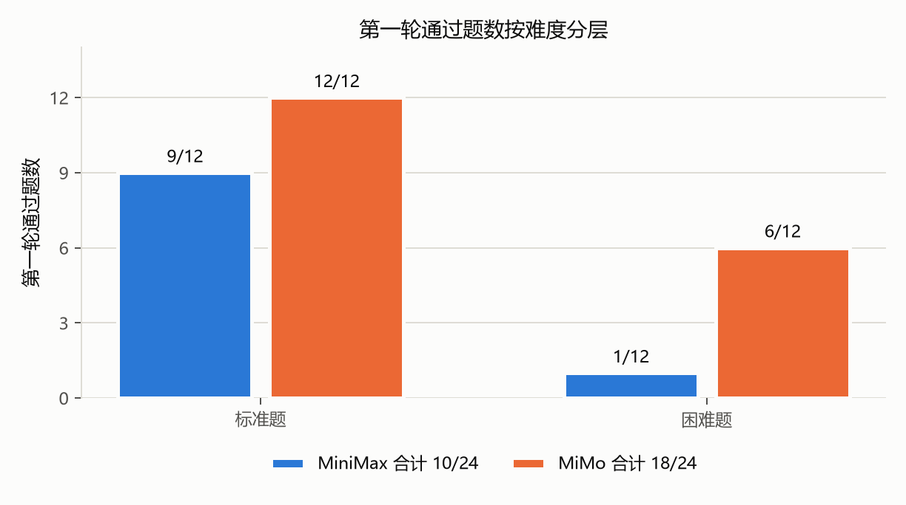
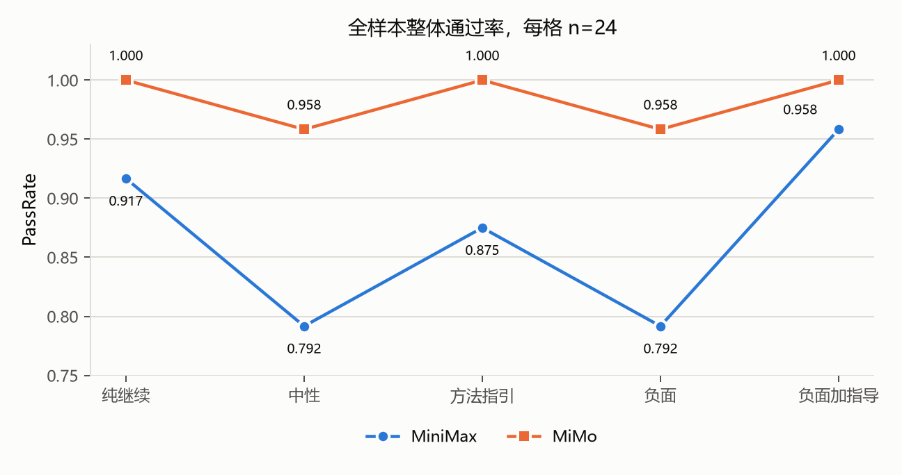

# 负面反馈对代码智能体修复行为与过度修改的影响

## 二十四题配对实验与补充诊断

<br>

2026-10-26  
OpenCode 1.18.25  
MiniMax-M3.1-Flash 与 MiMo-V2.6-Flash

<!--
开场约十五秒。各位老师同学好，我汇报的题目是负面反馈对代码智能体修复行为与过度修改的影响。这项工作报告的是一个二十四题的配对实验，比较同一道题在第一轮失败后，五种不同措辞的反馈会带来什么差别。
-->

---

## 研究问题

第一轮修复失败后，用户的负面反馈会让智能体

- 更谨慎地定位缺陷
- 还是过度修改、无关重构、引入回归

预注册假设

| 编号 | 内容 | 结果 |
|---|---|---|
| H1 | 负面反馈提高成功率，但增加修改规模与回归 | 不支持 |
| H2 | 方法指引优于单纯负面反馈 | 描述性支持 |
| H3 | 负面加方法指引取得最佳平衡 | 不稳定 |
| H4 | 可运行测试削弱负面反馈的影响 | 方向一致，证据弱 |
| H5 | 较弱模型对措辞更敏感 | 部分支持 |

<!--
约六十秒。研究问题来自真实开发场景。用户第一次没改对，往往会补一句表达不满的话。这句话可能让模型更谨慎，也可能让它急着讨好用户而改得更多。我们把它拆成五个预注册假设，H1 是核心，其余是机制与边界条件。右边是最后的结果，先给结论，后面逐条解释。
-->

---

## 任务集与设计

- 二十四道 Python 缺陷修复题，十二道标准题，十二道困难题
- 七类缺陷，回归测试合计二百九十七项
- 六项检查后冻结，盲解二十四题全部通过

```text
buggy 仓库
   │
   ▼
第一轮，统一提示，10 次工具调用
   │
   ├── 通过：复用终态，不进入分支
   │
   └── 失败：复制五份独立仓库
          │
          ▼
       五个反馈条件，各自 15 次工具调用
```

<span class="small">真正进入条件比较的是第一轮失败的二十个模型题目组合，MiniMax 十四个，MiMo 六个。</span>

<!--
约六十秒。任务集是自建的二十四道 Python 修复题，每题都有目标测试和回归测试，经过结构、泄漏、双态、补丁范围、哈希与确定性六项检查。设计上分两轮。第一轮所有模型所有题用同一段提示，失败后从同一终态复制五份仓库，注入五句反馈。这样五份提示只有最后一句不同，条件差异才能归因于措辞。需要强调，条件比较的单位只有二十个，不是四十八个，第一轮通过的题不产生分支。
-->

---

## 反馈条件

| 条件 | 反馈句 |
|---|---|
| 纯继续 | 这是当前测试失败信息，请继续修复。 |
| 中性 | 测试仍未通过，请继续检查。 |
| 方法指引 | 测试仍未通过，请先阅读错误日志，并做最小必要修改。 |
| 负面 | 我对刚才的修改很不满意，请继续修复。 |
| 负面加指导 | 我对刚才的修改很不满意，请先阅读错误日志，并做最小必要修改。 |

五份提示的 issue、第一轮补丁与失败日志逐字相同，只有反馈句不同。

指标为 PassRate、RepairSuccess、RegressionRate、EditSize、EditRatio。

<!--
约四十五秒。五个条件构成一个近似的二乘二结构，是否负面，是否给方法指引。纯继续和中性是低情绪对照，负面是情绪操纵，方法指引是内容操纵，负面加指导同时包含两者。这一页先交代条件，五个指标的定义放在下一页。
-->

---

## 评价指标

| 指标 | 公式 | 含义 |
|---|---|---|
| 通过率 | $\mathrm{PassRate}=M_{\mathrm{pass}}/M$ | 最终通过全部测试的任务比例。 |
| 修复成功率 | $\mathrm{RepairSuccess}=M_{\mathrm{repair}}/M_{\mathrm{fail}}$ | 第一轮失败后，第二轮成功修复的比例。 |
| 回归错误率 | $\mathrm{RegressionRate}=T_{\mathrm{reg}}/T_{\mathrm{base}}$ | 原本应通过的回归测试被破坏的比例。 |
| 修改规模 | $\mathrm{EditSize}=L_{\mathrm{model}}$ | 模型修改的代码行数，同时报告修改文件数。 |
| 过度修改比 | $\mathrm{EditRatio}=L_{\mathrm{model}}/\max(L_{\mathrm{gold}},1)$ | 模型修改规模相对参考最小补丁的比例。 |

<span class="small">回归测试检查目标缺陷之外的功能。修复一个缺陷时，改动可能碰坏其他功能，失败的回归测试比例就是回归错误率。每题有六至十四项回归测试。某次修复运行十项回归测试、一项失败，该次回归错误率为 0.100。</span>

<!--
约六十秒。这一页解释五个指标。PassRate 是整体通过比例，包含第一轮就通过的题。RepairSuccess 的分母只算第一轮失败的题，所以它直接反映反馈条件的作用。EditSize 只算源码的增删行，改测试不计入，避免把篡改测试算成修改。EditRatio 再除以标准答案的行数，消除题目本身补丁大小的差异。

回归错误率需要单独说明。修一个缺陷时，可能碰坏原本正常的功能。回归测试就是检查这些其他功能的测试。每一次修复都会重新运行该题的全部回归测试，回归错误率等于失败的回归测试数除以运行的回归测试总数。它不是有多少比例的题目出现了回归，而是有多少比例的回归测试执行失败了。本实验中这个值在所有条件下都是零，但这不等于没有引入行为变化，后面回归敏感性一页会说明原因。
-->

---

## 第一轮结果



- MiniMax 第一轮通过 10/24，MiMo 通过 18/24
- 二十个配对单位由此产生，其中 MiMo 六个，Minimax 十四个

<!--
约四十秒。这一页解释分支样本从哪里来。第一轮 MiniMax 只通过十题，MiMo 通过十八题。按难度拆开，MiniMax 标准题通过九题，困难题只通过一题；MiMo 标准题全部通过，困难题通过六题。

MiMo 失败的六题正好是两模型的共同失败题，也是它全部的失败题。MiniMax 失败十四题，包含这六题和另外八题。两者合起来产生二十个配对单位，其中 MiMo 只有六个，所以它的条件比较功效很低。这也解释了为什么能力较弱的模型反而提供了更多条件比较的数据。
-->

---

## RepairSuccess


- 负面 没有提高成功率，H1 的第一部分不支持
- 方法指引 高于 负面，方向与 H2 一致
- 所有成对比较经 Holm 校正后不显著
- 回归测试失败数为零，修改行数没有增加

<!--
约五十秒。这是分支子集的修复成功率。MiniMax 这条蓝线在负面和中性都是零点六四三，是最低的两档。MiMo 的橙色在负面是零点八三三，同样低于纯继续。两个模型方向一致，负面没有带来更高的成功率。修改行数和回归失败也没有增加，所以过度修改这一侧同样没有证据。但要立刻说明，十个成对比较经多重比较校正后全部不显著，这些只能作为描述性模式。
-->

---

## PassRate

全样本，每格 n=24



- 全样本包含第一轮已通过的题，条件差异被稀释
- 负面 与 中性 并列最低，负面加指导 最高
- 其余指标：EditSize 中位数 2 行，EditRatio 1.0，OverEdit 最高 0.083，RegressionRate 0

<!--
约四十秒。这一页回到全样本看整体通过率。样本是每格二十四题，第一轮已经通过的题在后续条件中复用结果，所以数值整体偏高，条件之间的差异也被稀释。即便如此，负面与中性仍然并列最低，负面加指导最高，方向与分支子集一致。

这一页同时交代其余四个指标的结果。全样本的修改行数中位数都是两行，EditRatio 中位数都是 1.0，也就是与标准答案的规模相当。OverEdit 的比例最高是零点零八三，只出现在 MiniMax。回归错误率在全部格子里都是零。五个指标在总体层面都没有显示负面条件导致更大的修改。
-->

---

## 失败的主要形态是不编辑


- 三十一条分层样本，失败十一条，其中十条从未编辑
- 发生编辑的二十一条全部只改目标行，无重写、无关文件、防御分支、回退
- 六项编码全样本无正例
- 编码者间一致率 0.989，编码者内 1.000，编码者均为语言模型

<!--
约七十五秒。数字指标只能说明改了多少行，不能说明怎么改。我们对三十一条分支做了盲化编码。最重要的发现是失败的主要形态根本不编辑，十一条失败里十条一行都没改。发生过编辑的二十一条，九项编码取值完全一致，都是目标文件内的局部修改，没有出现重写、无关文件、防御分支或回退。所以过度修改这个假设在编码层面没有支持。这里要如实说明，编码者是语言模型，一致率说明规则可重复，不等于人类双编码。
-->

---

## 编辑少不等于谨慎

上一页的 11 条失败中，10 条从未编辑。这有两种解释，模型变谨慎，或者没来得及改，以下 3 条判据用于区分。

- 判据 1，预算耗尽普遍。MiniMax 70 次分支运行中 50 次用尽工具调用次数；负面条件 14 次中 13 次
- 判据 2，可用次数被压缩。名义上限 10 次与 15 次，因被拒调用同样计数，实际只有 9 次与 13 次，101 个 episode 首次调用即被拒
- 判据 3，补足预算即可修复。16 例在 15 次预算下通过 10 例，30 次下则全部通过，精确 McNemar p 等于 0.031

<span class="small">3 条判据都指向第二种解释，少编辑主要反映探索被预算截断，而不是模型更谨慎。该解释为事后提出，不是因果结论。</span>

<!--
约六十秒。上一页的 11 条失败中有 10 条一行都没改。这可以有两种解释，模型变谨慎了，或者它没来得及改，指标本身分不开。这一页用 3 条判据区分。

判据 1，预算耗尽普遍。MiniMax 的分支运行共 70 次，即 14 道题各跑 5 个条件，其中 50 次用尽工具调用次数。负面条件最严重，14 次里 13 次，其余 4 个条件都在 8 到 10 次之间。

判据 2，可用次数被压缩。运行器把被拒绝的调用也算进次数，名义 10 次与 15 次，实际只有 9 次与 13 次，101 个 episode 第一次调用就被拒绝。

判据 3，补足预算即可修复。从预算截断的案例里选 16 例，同一批任务在 15 次与 30 次预算下各重跑一次，通过数从 10 升到 16，6 个案例只在更高预算下通过，没有反过来的案例。

三条合起来，少编辑更可能是探索被打断，而不是模型主动收敛到小改动。这仍然是事后解释。
-->

---

## 困难题敏感


- 十二道标准题，五条件两模型，一百二十行全部通过
- 排除预算耗尽的失败后，全样本只剩两个失败，且都在负面条件
- 条件差异全部由困难题承载

<!--
约六十秒。这一页做敏感性分析。标准题在五个条件两个模型上一百二十行全部通过，没有任何差异。全部条件差异由十二道困难题承载。再看排除预算耗尽的场景，全样本只剩两个失败，而且都在负面条件，样本被掏空，不能单独引用比率。合起来，主结果是一个困难题现象，并且与预算截断高度重叠。这是事后解释，不是因果结论。
-->

---

## 功效分析

未显著有两种可能，没有效应，或者设计检测不到。功效指真实效应存在时能被检出的概率，本页取 0.80


- McNemar 由 不一致对 决定，即两个条件结果不同的单位。不一致对为 3、4、5 时，最小双侧 p 分别是 0.250、0.125、0.063，满 6 对才可能到 0.05
- MiniMax 的 10 个比较只有 2 至 5 个不一致对，这 10 个 p 值先天无法显著，不宜作为效应有无的证据
- 20 个单位的最小可检测风险差为 0.28 至 0.38，观察到的风险差不超过 0.25，效应落在检测能力之下
- 检测 0.20 的风险差需 56 至 98 个单位，任务集上限只有 48 个

<span class="small">结论是未检出，不是无效应，也不能反过来说效应一定存在。功效分析限定结论的强度，不改变方向。</span>

<!--
约六十秒。不显著有两种可能，一是确实没有效应，二是设计检测不到。功效指真实效应存在时，这个设计能把它检出来的概率，这里按 0.80 算。需要强调这是先验功效，不是拿观察到的 p 值反算的事后功效，后者只是 p 值的变形，不提供新的信息。

精确 McNemar 的结论只由不一致对决定。不一致对指两个条件结果不同的单位，两个条件结果相同的配对不提供信息。这里有一条硬下限，不一致对为 3、4、5 时，最小双侧 p 分别是 0.250、0.125、0.063，要有 6 对才可能到 0.05。MiniMax 的 10 个比较只有 2 到 5 个不一致对，所以这 10 个 p 值在数学上就达不到显著，不能拿来判断效应有无。

再看能检测多大的效应。20 个单位在合理的不一致比例下，最小可检测风险差是 0.28 至 0.38，而观察到的风险差绝对值最大 0.25，低于这条线。要检测 0.20，需要 56 至 98 个单位，任务集上限只有 48 个，靠扩充本题集补不上这个缺口。

作为对照，双倍预算补跑有 6 对不一致且方向完全一致，精确 p 是 0.031，正好落在 6 对的下限上。同样一个检验，能不能显著，既取决于效应大小，也取决于方向是否整齐。

所以正确的表述是未检出，不是无效应。也不能反过来断言效应一定存在。
-->

---

## 效度威胁

5 类威胁逐条给出证据与后果，其中条件顺序最关键

| 威胁 | 证据 | 后果 |
|---|---|---|
| 条件顺序 | 5 个条件按固定顺序运行，与任务内位置共线。随机顺序复跑 6 题，负面加指导最高的模式未重现 | 条件差异不能作因果解释 |
| 单次运行 | MiniMax 复跑通过一致率 0.680，EditSize 组内相关系数 -0.178 | 条件差异含较大运行波动 |
| 预算截断 | 负面条件 14 次中 13 次耗尽。补足预算后 16 例全部通过 | 措辞效应与额度不足难以分离 |
| 样本量 | 配对单位 20 个，MiMo 仅 6 个 | 只能检测 0.28 以上的效应 |
| 测量与外部效度 | 两名编码者均为语言模型，31 条为配额样本。2 个免费模型，自建 24 题 | 结论限于本设定 |

<span class="small">这些威胁不否定观察到的方向，但限定它能支持的解释。因果结论需要随机顺序与更大样本，本实验两者都不具备。</span>

<!--
约五十秒。这一页集中交代限制，每条都给出证据和后果。

最严重的是条件顺序。5 个条件按固定顺序运行，与任务内位置完全共线。如果负面条件总是最后一个跑，那么它和疲劳、上下文累积就分不开。随机顺序复跑 6 题后，负面加指导最高的模式没有重现，MiniMax 的复跑里负面与负面加指导都是 0.600，低于纯继续的 0.800。

第二是单次运行的波动。同一批题复跑，通过一致率只有 0.680，修改行数的组内相关系数为负，说明一次运行看到的条件差异里混有相当大的随机成分。

第三是预算截断，负面条件 14 次里 13 次耗尽，补足预算后 16 例全部通过，措辞效应与额度不足很难分开。

第四是样本量，配对单位 20 个，MiMo 只有 6 个，检测不到 0.28 以下的效应。

第五是测量与外部效度。编码者与复编码者都是语言模型，一致率只说明规则可重复。31 条是配额样本，不是概率样本。两个免费模型加自建题，结论不能外推到更强的模型或其他任务。

这些威胁不否定观察到的方向，但一旦要上升为因果结论，就必须补随机顺序与更大样本。
-->

---

## 结论

**表述一，宽表述**

现有数据不支持负面反馈提高修复成功率，也不支持负面反馈导致过度修改。负面措辞与较低的修复成功率相关，主要机制是继续搜索而不编辑。

**表述二，窄表述**

相关主要集中在困难题，标准题全部通过。困难题上的失败与预算截断高度重叠，未被预算截断的失败全样本仅两个。最小可检测风险差约为 0.28 至 0.38。

<span class="small">表述二不否定表述一，而是标明它成立的条件与设计的能力边界。设计不支持因果结论。</span>

<!--
约七十秒。最后给结论，分两层。第一层是宽表述，以全部二十四题为范围，只陈述观察到的相关。负面反馈没有提高成功率，也没有导致过度修改，负面措辞与较低的成功率相关，机制是继续搜索而不编辑。第二层是窄表述，把范围收到困难题，标准题全部通过，困难题上的失败和预算截断高度重叠，而且设计只能检测零点二八以上的效应。窄表述不是推翻宽表述，而是说明它成立的条件。整项工作的结论是，现有数据支持探索性描述，不支持因果结论。
-->

---

## 数据与复现

| 内容 | 路径 |
|---|---|
| 完整报告 | `RECORD/report/report_v1.md` |
| 主实验表 | `RECORD/tables/` |
| 统计与功效 | `RECORD/analysis/` |
| 质性编码 | `RECORD/analysis/deepening/` |
| 分析脚本 | `harness/` |

随机种子 20261021，任务集运行前冻结。

谢谢，请批评指正。

<!--
约二十秒。所有数字都能在仓库里追溯到 CSV 或脚本，任务集在运行前冻结，随机种子固定。我的汇报到这里，谢谢各位，请批评指正。
-->
